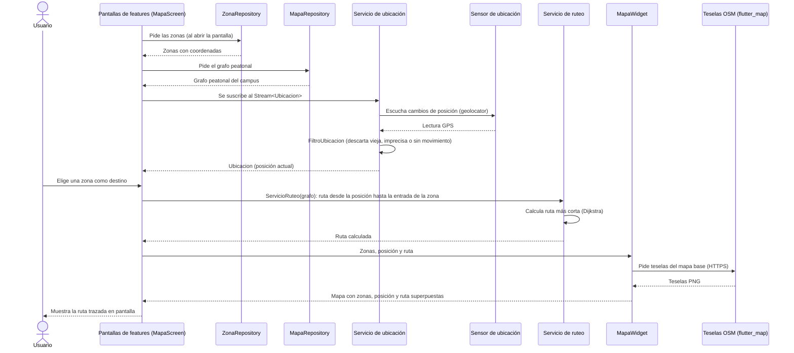
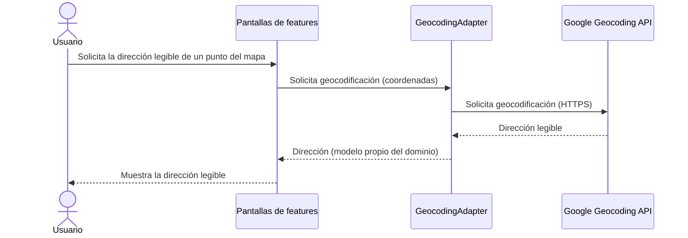
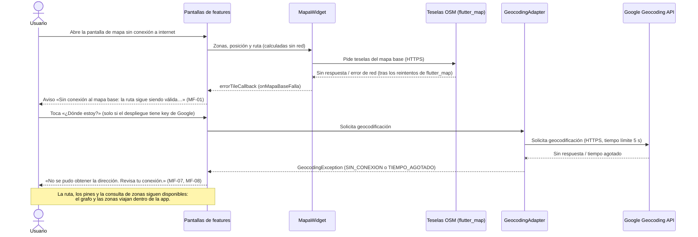
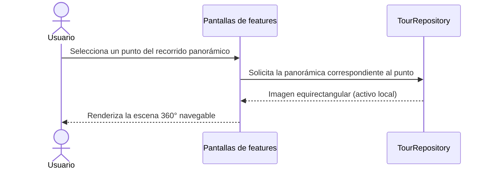

# Vista de Ejecución

Se documentan cuatro escenarios de ejecución, elegidos por su relevancia
arquitectónica: el flujo principal de ruteo (que atraviesa la mayoría de
los componentes de la sección 5 y usa `MapaWidget` sobre las teselas de
OpenStreetMap), el uso de un adaptador hacia un servicio externo de
Google (`GeocodingAdapter` para Geocoding API, opcional y apagado en
producción), el escenario de error más crítico del sistema (pérdida del
mapa base o de Geocoding, ver [Pérdida de disponibilidad](#esc-disponibilidad),
RT-01/RT-06 y los modos de fallo MF-01 a MF-15 en `11_technical_risks.adoc`),
y el flujo del tour panorámico, que está diferido (no implementado) y se
conserva solo como diseño.

## Trazar una ruta hacia un punto de interés

Flujo principal del sistema: el usuario selecciona una zona y la app
calcula y muestra la ruta más corta desde su posición actual hasta la
entrada de la zona, combinando el `Servicio de ubicación` (Observer, GPS
real con `geolocator` y `FiltroUbicacion`, ADR 0017), el `Servicio de
ruteo` (Dijkstra sobre el grafo propio, ADR 0013) y `MapaWidget`
(Adapter sobre `flutter_map` y las teselas de OpenStreetMap, ADR 0012).

1. Al abrir la pantalla de mapa, `MapaScreen` pide las zonas a `ZonaRepository` y el grafo peatonal a `MapaRepository` (ambos empaquetados en la app).
2. La pantalla se suscribe al `Stream<Ubicacion>` del `Servicio de ubicación`. `UbicacionServiceGps` lee el sensor con `geolocator` y `FiltroUbicacion` descarta las lecturas viejas (más de 10 s), imprecisas (más de 30 m) o sin movimiento (menos de 5 m) antes de emitir.
3. El usuario elige una zona como destino (lista «¿A dónde vas?» o un pin del mapa).
4. La pantalla crea `ServicioRuteo(grafo)` y le pide la ruta desde la posición actual hasta la entrada de la zona; el servicio la calcula con Dijkstra sin leer ningún repositorio.
5. La pantalla entrega a `MapaWidget` las zonas, la posición y la geometría de la ruta.
6. `MapaWidget` pide las teselas de OpenStreetMap con `flutter_map` (HTTPS) y dibuja encima las zonas, la posición y la ruta.
7. El usuario ve la ruta trazada en pantalla.

Si el GPS no da posición (sin permiso, ubicación apagada o 15 s sin una lectura válida), el stream emite
`UbicacionNoDisponible`; la pantalla dice el motivo y el usuario toca el mapa para marcar el punto de partida
(MF-04, ADR 0017). Lo mismo cuando la posición queda a más de 300 m del campus.

## Geocodificar una ubicación

Uso del segundo adaptador del sistema (`GeocodingAdapter`), que aísla al
resto de la app de Google Geocoding API.

1. El usuario solicita ver la dirección legible correspondiente a un punto del mapa (o, en el caso inverso, ingresa una dirección para ubicarla).
2. La UI delega la solicitud en `GeocodingAdapter`, sin conocer el SDK de Google directamente.
3. `GeocodingAdapter` traduce la solicitud al formato que espera Google Geocoding API y la invoca vía HTTPS.
4. Geocoding API responde con la dirección (o coordenadas) correspondiente.
5. `GeocodingAdapter` traduce la respuesta al modelo propio del dominio antes de devolverla a la UI.
6. La UI muestra el resultado al usuario.

## Pérdida del mapa base (teselas OSM) o de Geocoding API

Escenario de error correspondiente a DI-01 y al Escenario 3: el sistema
debe informar al usuario de forma clara en vez de bloquearse o fallar
silenciosamente cuando el servidor de teselas o Geocoding no responden.
Es el riesgo de mayor prioridad del proyecto (RT-01 y RT-06 en
`11_technical_risks.adoc`; modos de fallo MF-01, MF-07 y MF-08), porque
el sistema no tiene backend propio que pueda mitigar la caída.

1. El usuario abre la app sin conexión a internet (o con conexión degradada) e intenta usar el mapa. La pantalla ya tiene las zonas y el grafo, porque viajan dentro de la app, y calcula la ruta igual.
2. `MapaWidget` pide las teselas de OpenStreetMap con `flutter_map`; la librería reintenta cada tesela con espera creciente y, si aun así falla, llama a `errorTileCallback`.
3. `MapaWidget` lo reporta a `MapaScreen` (`onMapaBaseFalla`) en vez de dejar la pantalla en blanco o bloqueada.
4. La pantalla muestra una vez el aviso «Sin conexión al mapa base: la ruta sigue siendo válida…» y registra `mapa_base_sin_teselas` (MF-01, `test/mapa_test.dart`).
5. Si el despliegue tiene key de Google y el usuario toca «¿Dónde estoy?», `GeocodingAdapter` corta a los 5 s o ante el fallo de red y lanza `GeocodingException`; la pantalla muestra «No se pudo obtener la dirección» (MF-07, MF-08, `test/modos_de_fallo_test.dart`). En el despliegue público, sin key, el botón no aparece.
6. A pesar de ambos fallos, el ruteo interno (Dijkstra sobre el grafo propio) y la consulta de zonas/puntos de interés siguen funcionando, porque se resuelven contra activos locales.

## Ver una panorámica del tour (diferido)

**Diferido (no implementado):** no existen `TourRepository`, `lib/features/tour/`
ni panorámicas en `assets/`. Se conserva el flujo como diseño de referencia
por si se retoma el tour: el contenido panorámico sería un activo local
servido por `TourRepository`, sin red.

1. El usuario abre el módulo de tour y selecciona un punto del recorrido panorámico.
2. La UI solicita a `TourRepository` la imagen equirectangular correspondiente a ese punto.
3. `TourRepository` la sirve directamente desde los activos panorámicos empaquetados localmente, sin ninguna llamada de red.
4. La UI renderiza la escena 360° para que el usuario la navegue (el motor/librería de renderizado no está elegido — ver RT-02 en `11_technical_risks.adoc`).