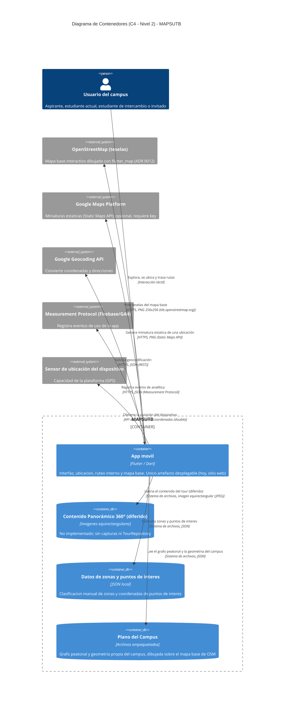

## Estado de implementación de los contenedores

| Contenedor | Estado | Evidencia / fecha objetivo |
|---|---|---|
| Datos de zonas y puntos de interés | Implementado (primera versión) | [`lib/repositories/zona_repository.dart`](../../lib/repositories/zona_repository.dart) |
| Plano del campus | Implementado (grafo peatonal) | [`lib/routing/mapa_repository.dart`](../../lib/routing/mapa_repository.dart) sobre [`assets/data/grafo.json`](../../assets/data/grafo.json) (ADR 0011, 0013); la geometría se dibuja sobre el mapa base de OSM ([`lib/adapters/mapa_widget.dart`](../../lib/adapters/mapa_widget.dart), ADR 0012) |
| Contenido panorámico 360° | Diferido (no implementado) | No existen `TourRepository`, `lib/features/tour/` ni panorámicas; sin fecha objetivo |

El contenedor del contenido panorámico está definido en la decisión de diseño (Repository, ver
[ADR 0002](../adr/0002-patrones-de-diseno-sin-realidad-aumentada.md)) pero todavía no tiene código
ni activos reales detrás: se declara así explícitamente en vez de dejarlo implícito en el diagrama.

Los modos de fallo de las relaciones externas (teselas, sensor, Geocoding, Static Maps, analítica)
están en [arc42 §11](../arc42/11_technical_risks.adoc#modos-de-fallo); la decisión de no extraer
ningún contenedor nuevo, en [ADR 0016](../adr/0016-no-extraer-modulos-por-ahora.md).

## Contrato de las integraciones HTTP

Las tres relaciones marcadas "HTTPS" en el diagrama (Static Maps API, Google Geocoding API y
Measurement Protocol) tienen contrato ejecutable versionado en
[`docs/api/apis-externas.openapi.yaml`](../api/apis-externas.openapi.yaml), implementación en
`lib/adapters/`, y prueba de contrato en `test/` (ver [ADR 0005](../adr/0005-integracion-apis-externas.md)).
Las teselas de OpenStreetMap quedan fuera de ese contrato: las pide la librería `flutter_map`, no una
llamada REST que el código propio de MAPSUTB construya (ADR 0012).
